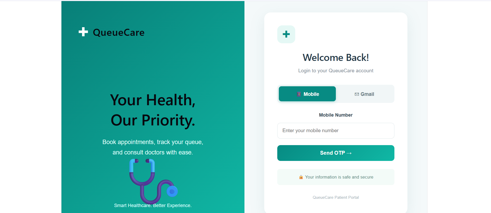

# QueueCare – Hospital Appointment & Live Queue Management System

## Project Overview

QueueCare is a hospital appointment booking and live queue management application. It helps patients book appointments with doctors and view their appointment details and queue status.

## Features

- Patient login using OTP verification
- Patient registration
- Book hospital appointments
- Select department and doctor
- View booked appointments
- Live queue information
- Patient profile details

## Screenshots

### Login Page

## Technologies Used

### Frontend
- React.js
- JavaScript
- HTML
- CSS
- Vite

### Backend
- Java
- Spring Boot
- REST API

### Database
- MySQL

### Tools
- Visual Studio Code
- Eclipse IDE
- MySQL Workbench
- Git
- GitHub
- Postman

## Project Repositories

- Frontend: https://github.com/Sreeharshaudatha/QueueCare-Frontend
- Backend: https://github.com/Sreeharshaudatha/QueueCare

## Project Purpose

This project was developed to practice Java Full Stack development by building a hospital appointment booking and queue management application using React, Spring Boot, and MySQL.

## Author

Sree Harsha Udatha
